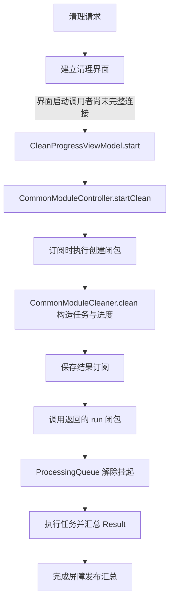

# CleanMyMac 清理队列与结果更新研究

研究日期：2026-10-21。对象：本机 CleanMyMac 5.7.2 arm64。留白保持 0.9.2，未修改产品、打包或推送。承接 [分类绑定研究](cleanmymac-cleaner-binding-re.md)。

本轮确认了“构造任务 → 订阅结果 → 启动队列 → 汇总结果”的静态连接，以及取消转发和成功节点筛选。**未完整接通预览界面的最终确认入口，也未运行原清理类。** 不把接口存在、反编译完成或结果条目等同于真实文件删除成功。

## 证据范围与方法

本地证据位于 `output/cleanmymac-re/clean-queue/`，包含输入 SHA-256、62 个定点函数导出及索引、ModuleCore 符号／绑定／汇编、ScanningCore 汇编与验证汇总。原始目标切片和伪代码只留本机，受现有 output 忽略规则保护。

推荐方案为复用 CleaningCore 项目，新增独立 ModuleCore／ScanningCore 项目定点取证；另一可行方案是实际界面清理观察，但会触及真实数据，未采用。KISS／DRY：复用 `DumpFunctions.java` 与桩解析器；YAGNI：不增加产品规则或通用研究框架；SOLID：分别核对界面、控制器、队列、任务结果和节点更新边界。

ModuleCore 自动分析达到 120 秒上限，并存在 Objective-C 分析器异常；随后定点导出均完成。ScanningCore 分析在 60 秒上限内完成。Ghidra 的 completed 只说明对应函数伪代码已生成，不说明类型推导和所有异常分支正确。

## 已确认的启动链



以下地址均为对应 arm64 切片内地址，不是运行时 ASLR 地址。

| 层次 | 地址 | 代码证据及边界 |
| --- | --- | --- |
| 清理界面请求 | ModuleCore `0x1ca0c → 0x1e618 → 0x1caf0` | 在 UIScheduler 安排回调，通过屏幕工厂建立并 push cleaning 界面；不是确认弹窗的充分证据 |
| 进度模型 | ModuleCore `0x5ac9c` | 通过 controller 协议槽调用 startClean，包装结果发布器；槽含义结合协议与控制器实现定位，不能当直接调用地址 |
| 创建发布器 | ModuleCore `0x2ed78` | `AnyPublisher.create` 包装 `0x30650 → 0x2ee98`，返回发布器与进入执行闭包是不同阶段 |
| 准备任务 | ModuleCore `0x2be40` | 取得任务处理器，调用 Node.addCleaningOperations，构造进度与结果流；返回 run 闭包 `0x2d034` |
| 订阅后启动 | ModuleCore `0x2ee98` | 先建立并存入 cancellables 的结果订阅，再调用返回的闭包；不是一取得预览节点就直接删除 |
| 启动闭包 | ModuleCore `0x2d034 → 0x2cf50` | 可选 beforeCleanClosure 后调用任务处理器 run（类槽 `+0x108`） |
| 队列启动 | CleaningCore `0x12988`；ScanningCore `0x1d1a0` | 前者转发 ProcessingQueue.run；后者安排任务、加入最终 barrier，再 setSuspended(false) |

ModuleCore 导入名经懒绑定桩校准，例如 `AnyPublisher.create`：实际桩 `0x124284`，初始 helper `0x126864`；Node.addCleaningOperations：实际桩 `0x124cec`，helper `0x1272cc`。ModuleCore 总计 806 个桩，804 个恢复懒绑定名，另外两个不在该懒绑定解析范围；本轮未对全部桩重复做独立 LLVM 数值比对，因此不沿用上轮 849 桩验证数量。

## 队列、取消与部分失败

CleaningCore `TasksProcessor.init`（`0x125ac`）将 ProcessingQueue 的 `maxConcurrentOperationCount` 设为 **1**。这是本处理器初始化的设置，不能推广成所有扫描队列都串行或任何运行配置永不覆盖它。

任务提交经过 `0x12bdc`，结果回调 `0x15cb4 → 0x13abc` 把任务信息和外层 `Result` 追加到 CleanQueueResult.items。失败也能成为一条结果，而不是只保留成功项。

ScanningCore `0x1daa4 → 0x1de38` 为任务建立 NSBlockOperation；执行闭包 `0x24778 → 0x213d8` 在执行前后处理暂停，调用任务协议的 execute，将其结果交给 `0x1fb94`。后者在 NSRecursiveLock 内经 `0x1fe10` 更新累积结果，并发布 QueueTaskFinishedEvent。这个通用结果路径没有发现遇到任一失败就调用全队列 cancel 的分支；结合独立 operation 的安排，可支持“单任务错误被收集，队列容许部分失败”的结论。**依赖解析、任务自己的副作用、取消或外部订阅仍可改变后续任务行为，不能保证每个后续任务必然执行。**

这里发现重要反编译偏差：`0x21858` 的伪代码把 `0x21924` 错误块移除；真实汇编 `0x21920` 检查 Swift 错误寄存器 x21，错误分支 `0x21954` 写枚举标签 1，成功分支 `0x21968` 写 0。不能因生成的 C 只剩成功路径，就判断 execute 不会抛错。

取消链有两种入口：

- 显式停止：ModuleCore `0x2faa8` 经 cleaner 协议 stop；CommonModuleCleaner `0x2d444` 转发任务处理器 cancel（槽 `+0x110`）。CleaningCore `0x12f24 → 0x12f48` 调用 GOT `0x200d0`，绑定为 ControlObject.cancel。
- 发布器返回的 Cancellable：`0x307ec → 0x2f878` 弱引用取得 controller 后调用同一 cleaner.stop 协议槽。不能据此声称任意一个下游订阅的取消必然等同于全局停止，仍取决于发布器共享及订阅生命周期。

ScanningCore `ControlObject.cancel`（`0x81a4`）设置取消标记 `+0x11=1`，同时清除暂停标记 `+0x10=0`，随后通知。它不是事务回滚。上轮文件任务只在具体路径处理边界检查取消；已经完成的移除没有在本链找到恢复动作，不应向用户承诺“停止即可恢复”。

## 汇总与节点更新

ScanningCore 最终 barrier `0x23ab0 → 0x1f4e8` 读取 isCancelled，将其取反写入 QueueResult 的完成状态，并携带累积结果调用完成回调。**完成状态与文件全部删除成功不是同一件事**：任务失败另存于 items。

ModuleCore 完成回调经 `0x2d748 → 0x2d040` 分派到 dispatch queue，再经 `0x2d788 → 0x2d264` 发送汇总值和 publisher 完成通知，之后调用可选 afterCleanClosure。控制器结果订阅 `0x30774 → 0x2f6e8` 向统计及 itemsContainer 提交 ModuleCleanResult。itemsContainer 的具体实现与缓存模块回调还未全部贯通，不能把下述通用 updater 认作所有分类唯一必经实现。

CleaningCore `CleanQueueResult.outcome`（`0x316c`）汇总外层任务 Result 和内层节点 Result。两个公开 getter 给出可直接核对的状态解释：

| 内部标签 | hasFailedResults（`0x3510`） | hasRemovedItems（`0x3524`） | 可解释含义 |
| --- | --- | --- | --- |
| 0 | false | true | 有移除结果，无失败标记 |
| 1 | true | true | 同时有移除结果和失败 |
| 2 | false | false | 无移除、无失败；空 items 直接走此分支 |
| 3 | true | false | 有失败，无移除标记 |

这是 getter 的行为解释，不声称恢复了 Swift 枚举正式 case 名；“有移除”沿用 API 语义，不是独立文件系统核验或实际回收字节数。

`CleanQueueResultNodesUpdater.update`（`0x3a24`）跳过外层失败，展开外层成功数组，再跳过内层失败，只把成功节点送入集合与递归更新 `0x3ed4`。递归逻辑还受 cascadeRemovalFilter 控制；不能把“失败节点不进入直接成功移除集合”扩大成“任何失败节点及父节点都永远原样保留”。另有引用节点更新器 `0x5868`，说明普通树和引用树有不同处理，尚未逐分支完整解释后者。

## 确认入口仍有的缺口

定位了 SelectionConfirmationCoordinator.activate（`0xcd7e0`）和 AlertSelectionConfirmationPresenter.confirm（`0xccbdc`）；后者确实建立 NSAlert、加入按钮并设置破坏性操作标记。但这是**选择确认**设施，尚未证明用户缓存每次清理必经它，更不能据其名字断言存在统一的最终删除确认页。

本轮没有恢复清理按钮 → 所有条件／提示 → 确认或取消 → CleanProgressViewModel.start 的完整路径，也没有验证扫描结果是否在执行前重新校验。下一轮优先追清理屏幕 coordinator 的启动调用者及具体缓存 itemsContainer／afterCleanClosure；需要动态验证时，应先完成可注入的临时目录与依赖隔离，不能拿用户目录试删。

## 验证与复现

- 62 行请求全部完成，按模块／入口排重为 62 个；包括转发函数，不等于 62 个完整业务能力通过测试。
- 四个输入模块全文件 SHA-256 前后相同；未修改安装包、留白或系统权限。
- ModuleCore 分析超时及 ObjC 异常、ScanningCore 错误块反编译遗漏均保留，不当作完整分析成功。
- 原目标清理类动态测试 **0**，未执行真实扫描、清理、UI 操作、特权 IPC 或许可／授权流程。未运行无关产品构建和 Rust 测试。

复用本轮已保存的项目时，使用原导出脚本：

```sh
JAVA_HOME=/opt/homebrew/opt/openjdk@21/libexec/openjdk.jdk/Contents/Home bash output/cleanmymac-re/tools/ghidra_12.1.4_PUBLIC/support/analyzeHeadless   output/cleanmymac-re/clean-queue/projects ModuleCore   -process ModuleCore.arm64 -noanalysis   -scriptPath scripts/research/cleanmymac   -postScript DumpFunctions.java output/cleanmymac-re/clean-queue/recheck-new 0x2be40 0x2ed78
```

输出目录必须换成未使用的名称，避免覆盖证据。ScanningCore 项目同目录，CleaningCore 仍位于上一轮 system-junk/projects；本轮本地临时 launcher 只辅助调用，不作为新增产品或通用工具交付。

本轮记录：[20261021-007](change-log.md#change-20261021-007)。
