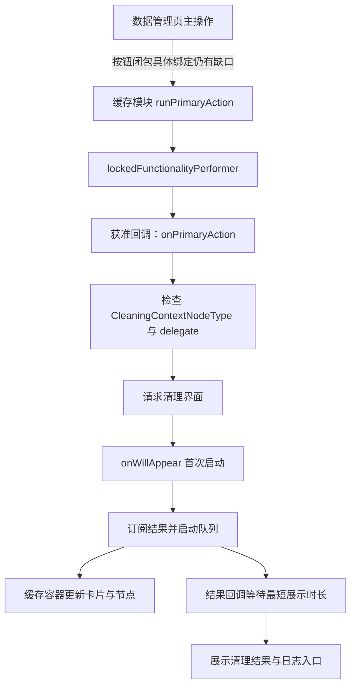

# CleanMyMac 清理入口与结果界面研究

日期：2026-10-21；目标：本机 CleanMyMac 5.7.2 arm64。承接 [队列研究](cleanmymac-clean-queue-re.md)，留白交付版本仍为 0.9.2。本轮补上清理页面生命周期、缓存主操作转发、缓存结果容器绑定与结果页导航；没有运行目标清理类。

## 已确认链路

图中检查属于已定位路径；未证明所有入口都经过统一的最终删除确认弹窗。没有修改或绕过 lockedFunctionalityPerformer，也未研究或调用授权／许可内部逻辑。

## 入口、启动与停止

| 位置 | 地址 | 观察及边界 |
| --- | --- | --- |
| 数据管理页主按钮 | ModuleCore `0x26ed8`、`0xc0868` | 协调器转发给视图模型；基础模型调用可选 onPerformMainAction 闭包。闭包的具体安装位置尚未接通 |
| 缓存主操作实现 | JunkCleanupModule `0xfffc` | 先记录选择统计，再经实际桩 `0x8d728` 调用 NodeDataManagerViewModel.runPrimaryAction；该方法与最终按钮闭包之间仍有缺口 |
| 主操作检查 | ModuleCore `0xc1700 → 0xc389c → 0xc17cc → 0xc2ad8` | 将操作闭包交给 lockedFunctionalityPerformer；闭包获调用后标记 ranPrimaryAction、记录统计并调用 onPrimaryAction。存在其它内部入口，因此不推断所有路径都采取相同检查 |
| 清理请求回调安装 | ModuleCore `0x26fec` | onActivate 安装 `0x27bf8 → 0x273ac` 回调；协议槽与 onPrimaryAction 的关系结合基础模型接口定位 |
| 清理上下文检查 | ModuleCore `0x273ac` | 检查节点遵循 CleaningContextNodeType；缺少上下文或 delegate 时记录日志，只有相应分支派发清理请求。这不是路径存在性或磁盘大小复核 |
| 建立清理页面 | ModuleCore `0x1ca0c → 0x1caf0`（前轮）、`0x482c8` | 工厂创建 CleaningScreenCoordinator，并将首次启动标记 `+0x48` 初始化为 0 |
| 首次出现 | ModuleCore `0x24e54` | 标记为 0 才置 1、记录开始时间、调用 viewModel.start 并保存订阅。对同一协调器对象有防重复启动控制，不等于全局任务去重 |
| 停止与离开 | ModuleCore `0x24ddc`、`0x5abac`、`0x25304` | 清理页主动作经视图模型停止接口转发 controller；页面失活清空订阅集合。结合前轮 Cancellable 的 stop 回调，可解释退出订阅与停止的连接；实际导航时序未动态验收 |

ReviewBeforeCleaningScreenCoordinator.performMainAction（`0x2426c`）只转发其 viewModel 的动作。该类型和前轮 SelectionConfirmationCoordinator 的存在，均不足以证明用户缓存清理必经统一预览确认。尚未确认执行前是否重新核验所有路径、选择与大小；不把 CleaningContextNodeType 检查当成这些核验。

## 缓存模块的结果更新已接通

前轮 CommonModuleController 的结果订阅 `0x2f6e8` 调用 itemsContainer 协议表的 `+0x20` 槽。本轮从缓存模块构造及实际表内容核对：

1. 缓存模块构造器把 `0xb4ac0` 作为容器协议表；该表 `0xb4ae0`（+0x20）指向 **`0x76aac`**。
2. `0x76aac` 取得容器 tilesUpdater，传入 CleanQueueResult、活动节点和更新闭包 **`0x76cfc`**。
3. 闭包 `0x76cfc → 0x768ac` 使用容器 `+0x68` 的 resultsUpdater，对 `+0xb8` 根节点提交结果。汇编 `0x768e4` 取结果数组，`0x76904` 调用更新协议槽。
4. resultsUpdater 协议表 **`0xb42d8`** 的方法槽指向 `0x6d778 → 0x6d26c`；后者先调用内层节点更新器，再执行 **`0x6d418`** 的结构后处理。
5. 内层更新器由缓存容器构造路径 `0x12030` 创建 `CleanQueueResultReferencableNodesUpdater.default(registry:)`。因此缓存实际使用的是处理引用关系的更新器，不能仅用普通树更新器代表全部行为。

ModuleCore **CleanQueueResultTilesUpdater.updateTiles（`0x53cd4`）** 在更新闭包前后分别调用可感知清理的卡片节点接口；即使没有相关卡片，也调用更新闭包。其收集辅助函数 `0x54040` 未在本轮完整展开，不能声称已经列全所有受影响卡片。

`0x6d418` 会遍历更新后的子树并进行额外结构处理；其中过滤器 `0x6d1d8` 及泛型协议语义没有全部恢复。本轮不能保证失败项及父节点一定原样保留，也不把这段处理解释成自动重试或重新选择。

协议表指针保存在本机 `junk-witness-pointers.json`，按 Mach-O 段映射读取；与构造器和调用处汇编配合使用，不将单纯 DATA 引用认作调用。

## 结果页、剩余项与数字来源

清理结果发布后，`0x25464 → 0x25130 → 0x2556c → 0x25240` 将 ModuleCleanResult 和视图模型中的条目交给 delegate。中间使用 MinimumDurationPerformer（`0x118554`）；工厂 `0x482c8` 设置的最短展示时长为 **1.6 秒**。这解释了任务已完成时仍可能短暂保留进度页，不是额外文件处理证据。

主流程 `0x1ce80 → 0x1e754 → 0x1cfd8` 在 UI scheduler 上建立并 push cleanResults 页面。`0x1cfd8` 将 outcome 标签 0／1／2／3 映射为 0／1／2／2 写入流程结果；正式枚举名称没有完全恢复，不随意命名这些值。通用结果视图模型 `hasFailedResults`（`0x61354`）仍采用上轮的失败判定，能够表达部分成功中的失败。

`CleanupCompleteViewModel` 构造（`0x6140c`）把 `hasMoreItemsAvailable` 传入展示配置；主操作、详情和日志分别有接口。导出的 `performDetailsAction` 等基础方法主要记录统计，不能仅凭其名称宣称按钮会自动重试失败项。`coordinatorDidRequestReviewRemainingItems` 经 `0x1dcb8 → 0x1e0e0 → 0x1e7ac → 0x1dcc8` 尝试导航返回，未发现此路径直接提交新的删除任务。

缓存结果构造器（JunkCleanupModule `0x13cec`，调用点 `0x13eb8`）使用 **TotalSizeableCleanQueueResultValueCollector.collect**。ModuleCore `0x11e64` 从任务／节点成功结果收集符合大小接口的节点并累加大小值。数字来自结果模型；该函数没有测量文件系统前后空闲空间，不能据此把“结果大小”当作 APFS 实际释放量。硬链接、共享块及快照等实际磁盘效果本轮未运行核验。

## 验证、限制与后续

- 62 行定点请求全部完成，按模块及函数入口排重为 62 个；含转发及旁支函数，不是 62 项业务测试。
- 一个请求误写为 `@0x693c`，实际导出 `0x6920`；保留记录，不用于结果容器更新结论。正确更新链来自 `0x768d0`、`0x76af0` 及协议表。
- ModuleCore、ScanningCore、CleaningCore、JunkCleanupModule 当前 SHA-256 均与前轮基线相同。没有另造本轮开始时的哈希采样时间。
- 复用前轮 Ghidra 项目，ModuleCore 前轮自动分析超时和 Swift／ObjC 类型恢复限制继续适用。原目标清理类动态测试为 **0**。
- 未操作目标 UI、扫描、删除、授权／许可或特权 IPC；无产品和研究工具代码变更，不运行无关构建，未提交／推送。

仍需追踪的具体缺口为：最终按钮闭包的安装者、选择确认的实际适用条件、执行前路径复核、缓存后处理过滤器及失败详情／重试的完整路径。下一轮应沿这些确定的地址和调用者继续，不扩展到其它清理分类。

本地证据目录：`output/cleanmymac-re/clean-ui/`，含各批函数／索引、协议表和 `verification-summary.json`；导出器仍为 `scripts/research/cleanmymac/DumpFunctions.java`。按 [前轮复现方式](cleanmymac-clean-queue-re.md) 使用对应既有项目，换用新输出目录以保留历史证据。

方案取舍：复用静态项目能隔离真实数据副作用，实际清理观察则可验证运行时配置但需要受控数据与依赖隔离，本轮采用前者。KISS／DRY 复用工具与证据，YAGNI 限定缓存链，SOLID 分清界面、队列与模型更新职责。

见 [本轮计划](plans/2026-10-21-cleanmymac-clean-ui.md) 与 [修改记录](change-log.md#change-20261021-008)。
