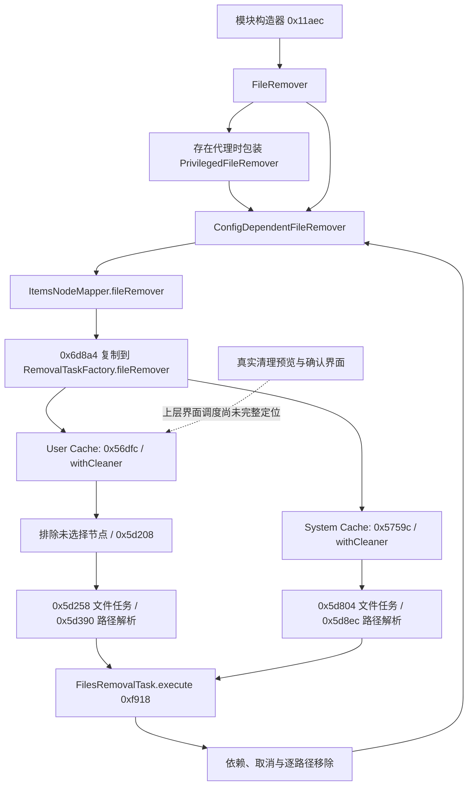

# CleanMyMac 用户缓存：节点到清理器的静态绑定

日期：2026-10-21。目标为本机 CleanMyMac **5.7.2**，留白保持 **0.9.2**。本轮补上了用户缓存节点、文件任务和移除器组合的静态连接；**未完成清理预览界面的端到端绑定，未执行目标清理类或真实删除**。

## 本轮解决的问题

此前仅能确认缓存扫描类及普通移除／废纸篓移除实现存在，不能说明缓存节点采用哪条通道。本轮确认节点映射器的移除器依赖被复制到任务工厂，用户缓存和系统缓存分别安装清理闭包，最终构造 FilesRemovalTask。用户缓存还存在按选择状态与容器属性决定路径的逻辑，因此不能将扫描出的缓存根目录无条件整目录删除。

采用静态调用、Mach-O 绑定和汇编交叉验证；替代方案是驱动原应用真实清理，因副作用和隔离不足而不采用。研究脚本不进入留白运行时，也不把第三方反编译代码作为产品源码。

## 证据链

图中地址按模块独立计算：0x11aec、0x6d8a4、0x56dfc 等在 JunkCleanupModule；0xf918 在 CleaningCore，不是运行时地址。依赖回环表示任务调用被注入的移除器，不表示递归调用自身。

| 模块／入口 | 确认内容 | 边界 |
| --- | --- | --- |
| JunkCleanupModule `0x11aec` | 创建 FileRemover；代理参数非空时包装 PrivilegedFileRemover，授权检查闭包为 `0x1236c`；之后包装 ConfigDependentFileRemover，传给 ItemsNodeMapper | 不证明当前代理已获授权；未读取实时配置 |
| `0x6d8a4` | 从映射器偏移 `+0x20` 复制移除器到新任务工厂 `+0x68`，与 ObjC ivar 元数据的 fileRemover 偏移吻合 | 其余数值类别参数未全部解码 |
| `0x4f534` | 同一分类调度函数直接调用用户缓存 `0x56dfc` 与系统缓存 `0x5759c` 等映射方法 | 不代表各分类都已同等深入验证 |
| `0x56dfc`、`0x5de30` | User Cache 节点安装带 selector／filter 的 withCleaner；初始化标识为 User Cache | 这里的标识不是实际 UI 语言或默认选择证据 |
| `0x5759c`、`0x5de54` | System Cache 节点安装另一 withCleaner；初始化标识为 System Cache；可见 CacheModel／CacheFileModel 元数据 | 系统缓存扫描完整规则仍未恢复 |
| `0x5e370` → `0x5d258` | 用户缓存回调从任务工厂取移除器，构造返回多个 URL 的 FilesRemovalTask；URL 回调 `0x5e388` → `0x5d390` | 依赖及未解决错误映射闭包的具体缓存策略未全部解析 |
| `0x5e294` → `0x5d804` | 系统缓存也构造 FilesRemovalTask，多 URL 回调为 `0x5d8ec` | 不能将两类缓存的路径选择规则视为相同 |
| CleaningCore `0xcaf8`、`0xc6ac` | withCleaner 构造 OperationBasedNodeCleaner，并安装到节点 | Swift 泛型参数存在反编译类型缺失 |
| `0xe13c` | 执行 selector、filter；过滤结果非空才调用任务操作并提交给 TasksProcessorType | 任务处理器排队、进度与 UI 确认流程未完整追踪 |

`CommonModuleCleaner` 的构造调用已定位到 JunkCleanupModule `0x10e30` 内的 `0x112b8`，但本轮没有将它到真实预览界面的一切状态转换全部连通，不能称为完整 UI 清理流程复刻。

## 用户缓存的选择与容器保护

`0x5d208` 通过导入字段偏移读取 NodesCore.SelectableTypedChildrenNode.selection，再读取 Selection `+0x28` 的状态，返回“状态不等于 2”。这不是根据变量名猜测：NodesCore `Selection.state.getter`（0x7770）读取同一偏移，`Selection.deselect`（0x80f8）在 0x816c／0x8170 将值 2 写入该位置；`Selection.select` 的对应分支写入 1。因此可以确认 2 对应取消选择，1 对应选择分支，而不必凭反编译临时变量推定含义。

用户缓存路径解析器 `0x5d390` 的分支为：

1. 取消选择（状态 2）返回空路径集合。
2. 状态 1 且 CacheFileModel.isContainer 为假，返回该模型自身的 URL。
3. 其余情况从 typedChildren 中取得适配的子节点，再递归应用同一路径解析器并合并 URL。

isContainer 也做了独立核对：SystemJunkScanning 的公开 getter 0x268e4 从类型元数据 `+0x1c` 获取字段偏移，与路径解析器读取位置一致。未将该属性误认成 isAutoselected。

这证明容器节点和普通文件／目录节点的策略不同；它不证明所有容器最终都保留全部内容，也不证明不存在其他过滤。状态 0 的正式枚举 case 名称仍未恢复，不额外命名。

系统缓存解析器 `0x5d8ec` 从 CacheModel.files 取 CacheFileModel 数组并返回其中 URL；公开 files getter 0x264fc 使用同一元数据 `+0x18` 字段偏移。该解析器本身没有用户缓存的逐子节点递归选择逻辑，不能直接外推为其上层完全没有选择过滤。

## 取消、依赖与失败处理

CleaningCore `FilesRemovalTask.execute`（0xf918）进入 `mapToCleanResultsUnlessCancelledWithDependencies`（0xbf54），再经 `mapToCleanResultsUnlessCancelled`（0xb9fc）调用 ScanningCore.mapUnlessCancelled。取消回调 `0xbae0` 构造 ControllableCancelledError，不能把取消当作成功完成。

`0xbfa4` 会提取依赖，并通过 Collection.unfulfilled(by:) 计算未满足集合；是否将其变成错误受可选 UnresolvedDependenciesErrorMapper 影响。不能据“有依赖接口”就声称所有未满足依赖都会自动阻止删除，本轮尚未完全解出缓存工厂传入闭包的具体政策。

逐节点回调 `0xf9b0` → `0xfa5c` 遍历解析出的 URL。单 URL 处理 `0xfbf4` 先检查 InnerControllable.isCancelled，再调用注入移除器；移除异常包装为 FileRemovalTaskError。节点内遇到失败会提前返回。尚无证据证明整个队列遇到一个错误就停止、自动重试或回滚已完成操作，不补造这些行为。

## 普通移除与特权回退

配置包装器保留 debug／real 两条通道，选择依赖运行时配置回调；本轮未读取该回调的实际值，不能将构造器存在等同于当前一定执行真实删除。

PrivilegedFileRemover.remove（0xa66c）先调用基础移除器，成功就返回。基础移除失败后：

- 检查 URL.hasSymlinkInPathAncestors；祖先含符号链接时走错误路径，不进入特权回退。
- 无该情况时调用注入的授权检查闭包；失败构造 NotAuthorizedPrivilegedAgentError。
- 检查通过后才调用特权文件系统客户端，并将客户端结果／错误继续转换。

祖先符号链接检查由 dyld 绑定及调用桩交叉确认，不是“权限错误分类”函数，也不能扩大解释为所有链接情况都已检查。没有调用真实助手、请求新授权或执行删除。

此处基础 FileRemover 是上一轮已确认的 `removeFileAndHandleLockAtPath:error:` 通道；本轮缓存绑定没有构造 MoveToTrashFileRemover。底层文件服务的锁处理和最终系统调用尚未完全追踪，不能仅凭方法名承诺永久删除或恢复行为。

## 工具校准与验证

Ghidra 的静态符号检索只返回 27 个相关元数据符号，未恢复所需导入名称。`otool -Iv` 也将许多调用桩显示为 LOCAL ABSOLUTE；没有因此认定“这些函数未使用”。改用当前原安装包的 `dyld_info -arch arm64 -fixups`，将绑定槽、arm64 调用桩和函数内 bl 指令连接起来。

新增只读脚本解析标准 ADRP／LDR／BR 桩及初始指针，解释了 Ghidra 为什么将真实 stub 0x8daf4 的 withCleaner 显示为指向初始懒绑定目标 0x8f930 的 thunk。例子：

| 用途 | 调用桩 | 绑定槽 | Ghidra 中出现的初始目标 |
| --- | --- | --- | --- |
| 用户缓存 withCleaner 重载 | 0x8dae8 | 0xb86b8 | 0x8f924 |
| 标准 withCleaner 重载 | 0x8daf4 | 0xb86c0 | 0x8f930 |
| FilesRemovalTask 多 URL 构造 | 0x8dadc | 0xb86b0 | 0x8f918 |
| 特权移除器构造 | 0x8db00 | 0xb86c8 | 0x8f93c |
| 祖先符号链接检查（CleaningCore） | 0x16c74 | 0x24020 | 0x17634 |

- 两个模块共 849 个调用桩的指针地址全部与独立 LLVM 反汇编交叉一致。JunkCleanupModule 懒绑定映射 641／643，CleaningCore 为 204／206；各有两个 C++ new／delete 从普通 GOT 绑定，不在当前懒绑定筛选内，未伪称全部名称已恢复。
- 自有最小 Mach-O 夹具的 7 项测试通过：正／负页偏移、错误指令、错误架构、截断命令、越界映射与文件支持的指针读取。这些验证研究工具，**不是目标清理类运行测试**。
- 共 80 行定点导出请求，其中 78 行完成；按模块及实际入口排重为 74 个函数，含转发及元数据函数，不是 74 条清理规则。0x5e3d4（JunkCleanupModule）和 0xc174（CleaningCore）未恢复为独立入口，保留失败记录，不计成功。
- 保留 ObjC retain／release 注入、不可达块、重叠全局与 Swift 类型缺失等反编译警告。完成标记不保证伪代码参数完全准确。系统缺少 swift-reflection-dump，未为此安装新工具；选择状态改由公开方法汇编核对。
- 八个目标模块前后哈希一致；重新提取两个 arm64 切片并与缓存分析切片逐字节哈希核对一致。目标和留白当前交付包的完整签名检查通过。
- 未操作目标 UI、未运行目标清理类，未清理真实数据、发起 IPC／授权／许可操作、修改产品或重新打包；未重复无关 Rust／产品 UI 测试。

## 复现与证据索引

复现入口见 [研究脚本说明](../scripts/research/cleanmymac/README.md)。本轮输出在 `output/cleanmymac-re/cleaner-binding/`，不上传目标二进制、伪代码或本机输出。

| 本地证据 | 用途 |
| --- | --- |
| targets.json、verification-summary.json | 版本边界、哈希与验证数量 |
| binding-symbols.json、binding-symbols-external.json | 初始符号检索的覆盖限制 |
| junk-fixups*、core-fixups*、*-stubs.json、*-stubs-llvm.txt | 操作系统绑定、调用桩及 LLVM 对照 |
| functions-junk-binding／factory-link／cache-bindings／cache-resolvers／user-cache-paths | 节点构造、工厂传递、选择与 URL 解析 |
| functions-core-task／selection／execution／guards／errors | 清理任务、取消、依赖与错误转换 |
| nodes-disassembly.txt、system-disassembly.txt | 选择状态值、isContainer／files 字段的公开 getter 对照 |

核心输入哈希：

- JunkCleanupModule：`03a6f487f68f33efda63bb8ff645ddc2ca10869c86458cd6cc187b53de76c5ad`。
- CleaningCore：`6c319515b9532ac1728c1c9f5a2c627c6313682d1574558c0e147c3de1ddc830`。

## 尚未完成与后续顺序

下一步优先追 CommonModuleCleaner／TasksProcessor 如何由真实预览与确认入口调用，及队列的异常继续、取消与界面结果更新。随后再深入缓存依赖闭包、实际 debug／real 配置和文件服务的锁处理。真实知识库内容仍未读出，不能用此轮绑定补作规则库已恢复的证据。

隔离验证方面，Swift 泛型任务和依赖／客户端闭包尚未形成可可靠构造的完整测试边界，因此本轮没有尝试用裸 ABI 拼装实例或把可能触及真实路径的对象当测试。只有完全限制输入与服务后，才能新增原类受控执行验证；当前结论是静态连接，不是完整清理器复刻。

KISS：复用已有项目，未引入依赖；YAGNI：只深入缓存相关链，其他分类导出仅作定位，未宣称同等覆盖；SOLID：区分节点选择、任务调度、路径解析和移除器；DRY：统一绑定槽与初始目标索引，避免各份伪代码分别猜测函数身份。

关联：[本轮计划](plans/2026-10-21-cleanmymac-cleaner-binding.md)、[上一轮知识库](cleanmymac-knowledge-base-re.md)、[修改记录](change-log.md#change-20261021-006)。
