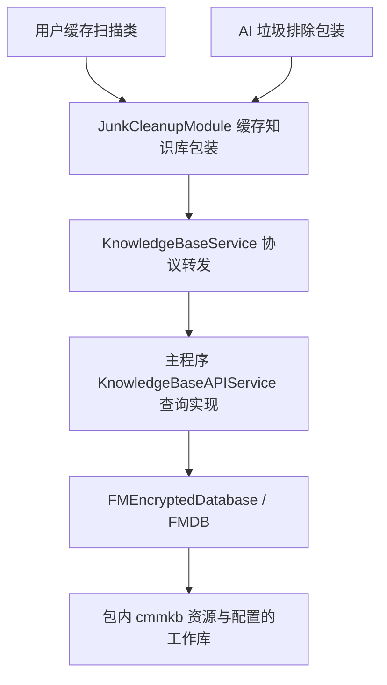

# CleanMyMac 缓存知识库执行链研究

日期：2026-10-21。目标为本机 CleanMyMac 5.7.2；留白保持 0.9.1。本轮完成选定查询链的静态取证和数据库读取对照，**没有读出真实规则库，也没有完整还原 CleanMyMac**。

## 范围与方案

推荐先定位真实查询实现，再用独立进程、自有数据库验证读取条件，适合解释规则来源且控制副作用。替代方案是观察真实扫描结果，适合核对用户可见行为，但既有配置与选择会影响结果，无法独立证明内部规则。本轮采用前者，未运行目标扫描或清理。

KISS：复用已安装的分析工具和统一导出脚本；YAGNI：不扩展到许可、授权或其他模块；SOLID：分别记录扫描包装、查询实现与数据库基础层证据；DRY：源码和证据共用索引。避免为了复刻外观提前引入未经验证的规则。

## 真实调用层次

图表示静态调用与数据加载关系，不表示本轮已运行完整链。包内资源与运行时工作库不能混为一谈，本轮未打开用户工作库。

| 模块／地址 | 已确认行为 | 保留限制 |
| --- | --- | --- |
| JunkCleanupModule `0x3cc58` → `0x3d664` | 基础忽略为假后继续检查多个类别的自定义忽略 | 静态类别数组尚未解码；参数 `0xd` 不能直接称为 13 个类别 |
| JunkCleanupModule `0x3cc64` | 深入扫描判断通过协议偏移 `+0x50` 转发 | 深入名单真实内容未知 |
| JunkCleanupModule `0x1fe04` → `0x1fbec` | 先查基础忽略，再查额外返回值是否存在 | AI 排除索引的具体算法未解析 |
| KnowledgeBaseService `0x4d6c`、`0x4eb0`、`0x4f34`、`0x50d4` | 基础忽略、单／多类别忽略、深入扫描分别转发到服务 | 协议转发本身不包含完整规则 |
| 主程序 `0x1001a6d60` | 执行 ScanItems 查询，读取 IsRegex、Value、GroupType 等并匹配 | 合并、缓存与去重后段未完全恢复 |
| 主程序 `0x1001a83e8` | 查询 UserIgnore，与自定义忽略相关 | 可选参数语义与完整 SQL 谓词尚未恢复 |
| 主程序 `0x10019f028` | 数据库 open 后由 `0x10019f32c` 生成 Data，调用 setKeyWithData: | 未获得最终密钥或真实规则表 |

框架地址从零起，主程序地址含 `0x100000000` 映像基址，不能相互套用。

## 查询与匹配证据

主程序 `0x1001a3828` 初始化 SQL 常量，包含 `SELECT * FROM ScanItems`、`SELECT * FROM UserIgnore`、ApplicationFiles、ApplicationInfo、GroupType 与 General 查询。`0x1001a3028` 使用 `SELECT count(*) FROM sqlite_master` 检查数据库。这里证明代码含对应查询，不等于查询已成功执行，也不是完整表结构。

在 `0x1001a6d60` 中，可见 executeQuery:values:error:、IsRegex 字段读取及字符串 `true` 判断：精确分支读取 Value 后转小写再比较，部分路径额外核对 GroupType；正则分支调用 StringProtocol.range，选项原始值为 `0x400`。没有证据证明正则分支也统一忽略大小写。结果组织涉及 RecordID、ScannerID、GroupType，辅助函数为 `0x1001a7ad8`。

`0x1001a78c0` 构造 ScanItems 条件与绑定参数，存在字符串 true 条件和组合表达式；`0x1001a89d4` 构造 UserIgnore 条件，包含由参数标记控制的可选整数条件。Swift 泛型条件构造仍有间接调用，尚不能输出可信的完整 WHERE 子句、类别映射或优先级。`0x1001a8dc0` 属于写入／executeUpdate 分支，只做静态导出，未执行。

## 数据加载与受控验证

KnowledgeBaseService `0x4770` 设置 `PRAGMA cipher_default_compatibility = 3`。主程序的 FMEncryptedDatabase.open 调用动态 Data 生成帮助函数；其中包含类名／选择子构造、动态调用和结果转换。最终数据未恢复，不能把包内 `.cmmkb` 当普通 SQLite，不能声称已解密。

独立进程仅链接安装包 FMDB.framework，未调用主程序的 ConnectionManager、configure 或全局实例初始化，以免接入用户工作库或注册监听。探针执行四组对照：

| 对照 | 结果 |
| --- | --- |
| 自有加密库，正确测试密钥，只读打开 | 读取 ScanItems 数量为 1；UPDATE 被拒绝 |
| 同一自有库，错误测试密钥 | 查询失败，错误码 26 |
| 安装包 info.cmmkb 的独立副本，无密钥、只读 | 查询失败，错误码 26 |
| 安装包 userInfo.cmmkb 的独立副本，无密钥、只读 | 查询失败，错误码 26 |

框架返回 cipher_version 为 3.4.2。错误码 26 的文本为 `file is not a database`；单凭该错误不能排除其他格式因素。结合静态 setKeyWithData: 路径，可以确认当前无密钥读取方式不足，不能进一步推断规则内容。

这只验证 FMDB 的读取对照，**没有执行真实 KnowledgeBaseAPIService 的匹配 API**。自有样本表是探针定义，不是真实库 schema；测试密钥仅用于自建数据库。前轮 8 组扫描类替身测试也不能补作本轮真实知识库验收。

## 证据、复现与校验

原始证据在 `output/cleanmymac-re/knowledge-base/`：targets.json、各 functions-* 目录的 function-index.json 与伪代码、main-import.log、main-disassembly.txt、probe-result.json、probe.stderr.txt、verification-summary.json。输出目录是本地产物，可能因后续清理不可用，因此关键结论保存在本文。

共导出 36 行入口记录，按模块与实际函数地址排重为 32 个函数；均标记反编译完成，包含初始化、辅助及转发函数，不能称为 32 条规则。主程序 Ghidra 记录了 Objective-C 类型编码 T 不支持与部分地址映射警告；反编译完成不代表每个参数和分支都准确。Swift 字符串引用可能指向字符串前部，空引用列表不证明该字符串未使用。

六个模块和两个包内资源的前后 SHA-256 全部一致；资源副本在探针结束后与已记录的源哈希相同。CleanMyMac 完整签名与留白交付包签名验证均通过。留白版本未变；未运行无关 Rust、界面测试或重新打包。

复现源码见 [研究脚本](../scripts/research/cleanmymac/README.md)。DumpFunctions 支持精确入口与显式 @指令地址，后者寻找所属函数并记录实际入口，避免将函数中间指令冒充新函数。原始目标不修改，新增样本使用 UUID 目录，不自动删除既有文件。

## 尚未完成

真实 cmmkb 表内容、类别枚举与深入扫描名单、完整 SQL 谓词、结果合并和去重顺序、真实知识库匹配 API 端到端验证、界面结果与清理器绑定均未完成。下一阶段应优先解决可隔离的数据来源与匹配验证条件；这些证据齐全前，不把观察到的结构照搬为留白清理规则，也不扩大删除范围。

本轮没有实际清理、修改用户知识库、权限操作、许可绕过或目标界面操作。
