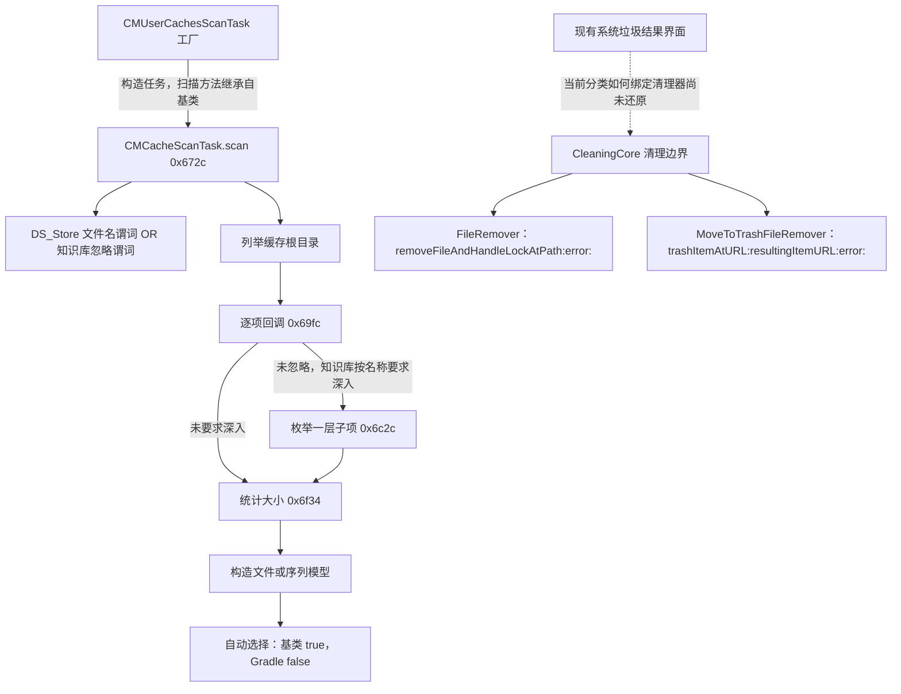

# CleanMyMac 系统垃圾：用户缓存核心链逆向证据

日期：2026-10-20。目标为本机 `/Applications/CleanMyMac_5.app`，版本 **5.7.2**。留白保持 **0.9.1**，本轮没有修改产品功能或重新打包。

本轮已进入函数级反编译和原生目标类执行验证，超出此前元数据及符号调查。覆盖的是系统垃圾模块中的**用户缓存通用执行链**及部分清理核心边界，不能称为整个系统垃圾模块或 CleanMyMac 完全还原。

## 工具与证据

- REA 6.7.0，独立 Ghidra 12.1.4；Java 21.0.12.1。Ghidra 来自 [官方发布页](https://github.com/NationalSecurityAgency/ghidra/releases/tag/Ghidra_12.1.4_build)，下载文件 SHA-256 为 `ddac49f903da9d5bac833e5cc79395098b9c33cfd3279be5f31bd00387d2d4db`，已与官方发布资产核对。
- 初次 doctor 因缺少 macOS arm64 原生反编译器失败；用发布包自带 C++ 源码及系统 clang++ 构建 ghidra_opt，放入独立安装的 os/mac_arm_64/decompile 后，doctor 退出 0。没有修改 REA、代理注册或系统权限来绕过检查。
- 从原应用只读提取 arm64 切片；SystemJunkScanning 切片 SHA-256：`289bc5ece42eb004a0fe757bfd3710bf3a0167ef056eca0c40cb4da0665a294c`。下文地址均为各自 **arm64 切片内的静态分析地址**，不是进程中的实际地址，不能跨版本套用。
- REA analyze、search、decompile 实际通过，缓存 scan 反编译证据为 `cache-scan.json`。随后复用 Ghidra 本地数据库批量导出选定函数，避免每次重复完整分析。
- 共获得 **22 个选定入口的伪代码与直接调用／入口引用记录**，含构造器、辅助函数和消息桩；不代表 22 条独立规则，更不代表全部函数覆盖。伪代码是反编译结果，保留类型／控制流警告，不是原始源码。
- 六个研究框架的原始文件前后 SHA-256 一致，目标完整签名校验通过。留白当前交付包的完整签名校验也通过。

原始证据根：`output/cleanmymac-re/system-junk/`；工具位于 `output/cleanmymac-re/tools/`。工具目录本次 du 显示约 1.4G，保留发布归档、安装和编译结果供后续研究；三个分析项目合计约 23M。它们不是留白运行依赖，不上传远程分析服务。

## 调用关系与边界

上半部分有反编译及受控原生执行证据；下半部分确认了清理核心中不同实现的存在与调用。虚线不是已确认的端到端绑定。没有由“用户缓存任务存在”推定某类文件必然采用永久删除。

| 模块／地址 | 实际观察 | 证据 |
| --- | --- | --- |
| SystemJunkScanning 0x9c4c、0xb5e0 | 用户缓存与 Gradle 工厂分别取 userCaches／gradleCaches，再使用同一构造链 | functions/ 对应伪代码及入口引用 |
| 0x6510、0x65e0 | 便捷构造使用默认文件服务；完整构造允许注入缓存 URL、文件管理与大小服务，并创建进度对象 | 原生样本使用完整构造，不调用默认目录工厂 |
| 0x672c、0x69fc | 建立忽略谓词、列举根目录、检查暂停／取消、判断是否深入、生成扫描结果 | REA cache-scan.json；functions-followup/ |
| 0x6c2c | 对指定项枚举一层子项，忽略后逐项计量并建立序列；空序列返回 nil | 不是“每层递归应用忽略规则”的证据，子目录真实大小算法仍属于外部服务 |
| 0x6f34 | 本地大小为零且不可读时，仅在特权接口报告已授权后请求特权大小；否则返回零 | 原生样本的特权对象是替身，不进行 IPC 或授权 |
| 0x7130、0xb6a0 | 基类 isResultAutoselectable 返回 true；Gradle 覆写返回 false | 反编译常量返回 + 原生 selectedSize 对照 |
| LegacyScanningCore 0x1550、0x1a0c | 知识库忽略先检查完整路径，再检查名称；文件名谓词做最后一段名称的相等比较；支持 NSString、NSURL、CMFTSEntity，未知类型返回 false | functions-predicate/；名称与路径两组原生样本 |
| CleaningCore 0x9c20 → 0x18020 | FileRemover 发送 removeFileAndHandleLockAtPath:error:，失败分支转 Swift 错误 | 伪代码 + otool 对消息桩选择子的独立确认；该自定义服务内部锁处理／最终文件操作未还原 |
| CleaningCore 0x9d5c → 0xa3ac → 0x18060 | MoveToTrashFileRemover 调用 NSFileManager 的 trashItemAtURL:resultingItemURL:error: | 伪代码及清理消息桩；没有执行此方法 |
| CleaningCore 0xa25c → 0x9aa4、0xa66c | 存在配置相关的清理器分派、特权清理及错误路径 | Swift 闭包／协议见证调用尚未全解析，不能据此确定当前分类的策略 |

## 已验证的扫描判断

以下均限定于本版本上述缓存基类，不外推为所有清理模块的规则。

1. `.DS_Store` 由文件名谓词忽略；知识库忽略谓词与之组成 OR。
2. 知识库忽略通过 `isIgnoreItem:` 依次核对完整路径和最后一段名称；实际规则匹配方式仍由知识库负责。这里不把该调用推断成前缀、正则或通配符。
3. 根目录项是否进入子项由 `shouldPerformDeepSearchForItem:` 判断，传入最后一段名称。
4. 未深入的根目录项只有在未取消且“特权接口已授权或测得大小非零”时才生成模型。因此零大小不一定不出现，必须结合分支与授权状态。
5. 深入分支对未忽略子项不使用上述非零门槛，零大小子项也能生成模型；只要序列有子项，就可能返回总大小为零的序列。
6. 自动选择由任务的 isResultAutoselectable 决定，基类和 Gradle 已验证不同；不能把“属于缓存”一概推定为默认勾选。
7. 顶层开始时已取消会生成空扫描结果；逐项处理中也检查取消。该项来自静态证据，未专门执行取消样本，不推断上层 UI 如何表达取消。

## 受控原生验证：8 组通过

测试程序链接安装包内的 SystemJunkScanning.framework，子类仅提供固定测试 identifier；实际执行继承的目标 scan 方法。没有把上述判断重写成算法再自测。

所有枚举及大小接口都注入受限替身：拒绝样本根之外的路径，不实现删除接口；知识库为 nil 或确定性替身，特权对象只返回布尔与样本大小，不发起系统请求。数字是人为设定的分支测试输入，不代表真实磁盘测量。真实文件仅在 output 下新建的 UUID 样本目录中；7 个样本文件测试后仍为原始 `fixture` 内容。

| 样本 | 目标返回结果 | 验证含义 |
| --- | --- | --- |
| 基类、未授权 | 仅 normal.cache；size=100，selectedSize=100 | DS_Store 被忽略，顶层零大小项被过滤，基类自动选择 |
| Gradle、未授权 | 同一项、size=100，selectedSize=0 | 扫描与自动选择是两层决策 |
| 已授权替身、不可读大小回退 37 | normal、zero、blocked；总大小 137，特权大小替身仅调用 1 次 | 仅不可读零大小走特权回退；普通零项也可生成模型 |
| 已授权替身、回退仍为零 | 上述三项仍出现，总大小 100 | 不能只以非零大小解释模型存在条件 |
| 名称忽略 normal.cache | 结果为空 | 目标确实向知识库询问名称 |
| 完整路径忽略 normal.cache | 结果为空 | 目标确实向知识库询问完整路径 |
| 深入 branch.cache | 子项 child.cache 与 zero-child.cache，合计 37 | 深入分支保留零大小子项，仍忽略 DS_Store |
| 深入且忽略 child.cache | 只剩 zero-child.cache，序列总大小为零 | 空序列与非空零大小序列是不同判断 |

测试源码见 [CacheFixture.m](../scripts/research/cleanmymac/CacheFixture.m)，步骤见 [复现说明](../scripts/research/cleanmymac/README.md)。没有执行真实文件清理、真实特权助手调用或许可绕过。

## 真实界面观察

目标已在运行；先用不弹窗的权限检查确认现有辅助功能与录屏状态可用，再通过 REA observe-native-ui 读取确切 PID／窗口。没有点击按钮、切换分类、改变勾选或启动新扫描。

观察到现有「垃圾清理管理器」按系统垃圾、邮件附件、废纸篓组织；系统垃圾内包括用户缓存、通用二进制、系统／用户日志、语言文件等。用户缓存当前显示总量 28.9 GB、已选 21.7 GB；底部初始与结束都显示已选择 1101 项、21.8 GB。它们是已有结果与当前选择，**不是本轮重扫结果、默认选择证明或可实际释放量承诺**。

三次 AX 读取的节点上限为 250／1500／250，均发生截断。截图有助于核对可见界面，但不能据此宣称完整枚举全部条目。没有用全盘重扫来伪装为受控样本验证。

## 尚未还原与下一步

- 真实知识库 `info.cmmkb`／`userInfo.cmmkb` 是未解析的二进制资源；未确认其编码、压缩或加密方式，未得到真实忽略清单、深搜名单或更新覆盖顺序。测试替身不能填补这个缺口。
- 已定位缓存和 Gradle 工厂，但 CMPaths 的实际路径展开、不同系统版本的路径差异、沙盒／应用组数据覆盖未完整验证。
- 没有完整追到 JunkCleanupModule 每个分类如何选用 ConfigDependentFileRemover、普通移除、废纸篓或特权清理；没有执行最终删除、失败重试及恢复流程。
- 真正文件服务的递归大小、链接、克隆、锁处理和特权进程校验仍未还原；8 组注入样本只验证扫描类的判断及结果构造。
- 日志、Xcode、语言文件、通用二进制等仅有入口线索，未作同等深度验证；防护、卸载及更新模块不属于本轮范围。

下一阶段应先从 CachesKnowledgeBase 的真实 isIgnoreItem／shouldPerformDeepSearchForItem 实现及资源读取链继续，再追 UI 分类到具体清理器的绑定；不能直接把此报告的分支或界面数字写成留白的删除规则。

## 本地证据索引

| 编号 | 文件 | 用途 |
| --- | --- | --- |
| E01 | ghidra-release.json、doctor.json、doctor-ready.json、ghidra-native-build.log | 下载来源、缺失原生工具的失败及修复 |
| E02 | targets.json、SystemJunkScanning.arm64、system-overview.json | 目标哈希、架构及分析配置 |
| E03 | system-search.json、cache-scan.json、system.snapshot.json | REA 函数检索与实际反编译 |
| E04 | evidence-functions.json；functions*/function-index.json 与 .c | 22 个函数及消息桩、直接引用，保留反编译警告 |
| E05 | cleaning-objc-stubs.txt、cleaning-disassembly.txt、*-objc.txt | 消息选择子和 ObjC 元数据交叉核对 |
| E06 | fixture-result.json、fixture-build.log、fixture.stderr.txt、fixture-* | 8 组目标类运行及样本内容；initial-four-cases 为此前四组结果 |
| E07 | ui-preflight.json、ui-initial.json／.png、ui-expanded.json、ui-final.json、ui-summary.json | 权限预检、现有窗口与截断范围、前后选择状态 |
| E08 | target-codesign.txt | 目标完整签名复核 |

本地 output 可能被清理，主要结论保存在本文；可复用的自有研究脚本放入 scripts/research/cleanmymac，不加入产品执行链。关联：[本轮计划](plans/2026-10-20-cleanmymac-system-junk.md)、[修改记录](change-log.md#change-20261020-006)。

2026-10-21 续篇：[缓存知识库执行链](cleanmymac-knowledge-base-re.md) 已定位真实查询实现并完成 FMDB 读取对照；真实规则内容仍未读出，不替代本文的历史验证边界。
